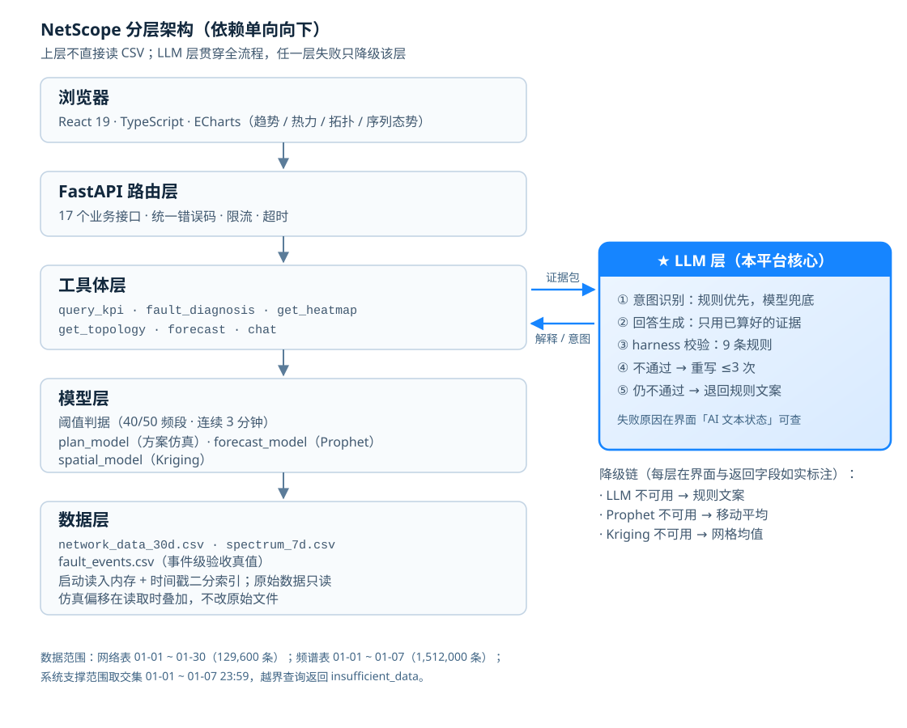

# 无线知微（NetScope）——以自然语言驱动的无线网络监测、研判与处置平台

> 🌐 **在线预览**：<https://ai-net-dgut.github.io/NetScope/> ｜ ⚡ **快速开始**：[本地部署](#快速开始) ｜ 📄 **部署细节**：[DEPLOY.md](DEPLOY.md)
>
> 在线版可直接打开看界面与图表（提问、研判、方案仿真等功能需要后端服务）；本地部署可跑通全部功能，步骤见[快速开始](#快速开始)。

一句话概括：把"找对象 → 查证据 → 判故障 → 给方案 → 看效果 → 可回滚"这条排障链路，收成**一句自然语言提问**。

---

## 一、当前版本聚焦校园场景

**本版本（含在线预览与本地部署）只面向校园无线网这一个场景**，不是多场景并列的通用平台。具体边界如下：

| 维度 | 当前版本现状 |
|---|---|
| **场景范围** | **仅校园**（教学楼 / 图书馆 / 操场 / 宿舍 构成的园区无线网） |
| **网络规模** | 3 个接入点（AP-01 ~ AP-03）+ 3 条移动用户轨迹（UE-01 ~ UE-03），坐标范围 0 ~ 500 m |
| **数据时间** | 2026-01-01 ~ 2026-01-07 23:59（网络表 30 天，频谱表 7 天，系统口径取交集） |
| **首屏场景说明** | 首页固定展示「校园场景 · 教学楼 / 图书馆 / 操场 / 宿舍」，不再提供场景切换入口 |
| **场景字段** | 数据字典里的 `scenario` 列保留 `校园 / 商场 / 体育馆` 三种取值以兼容后续扩展，**但本版本只加载校园数据** |
| **其它场景** | 商场、体育馆、智慧交通、智慧园区等场景**尚未接入数据**，界面上不提供入口 |

**为什么先聚焦校园**：园区无线网的痛点最典型——楼宇多、用户密集、指标分散，故障往往等投诉才被发现。我们选择把一个场景的**完整闭环**（监测 → 研判 → 方案 → 仿真 → 回滚 → 记录）做透并全部可复现验证，而不是在多个场景上各做一层浅演示。

**扩展到其它场景需要什么**：一份同结构的场景数据 CSV（含 `scenario` 标签与 AP/UE 坐标）+ 场景元数据，架构、接口与前端页面无需改动（详见 [docs/real_data.md](docs/real_data.md)）。

---

## 二、项目简介

校园无线网覆盖楼宇多、接入用户密集，传统运维高度依赖少数专家：故障往往在用户投诉后才人工到场排查，指标分散在多张表里、根因判断慢，信号与频谱异常通常要等到影响上网体验后才被发现。

针对这一真实痛点，无线知微把大语言模型（LLM）智能体的**意图驱动**能力引入无线网络监测与管控：网络测试与优化人员一句话就能完成"主动预警 → 查证据 → 判故障 → 给方案 → 看效果 → 可回滚"的闭环；平台以校园无线网为首要落地场景，架构按多接入点组网（校园 / 商场 / 5G 现网）设计，可平滑扩展。

* **数据层**：支持仿真数据生成与 CSV 导入，当前数据集为 3 个 AP + 3 条移动用户轨迹、逐分钟采样；18 维数据字典覆盖核心 KPI、AP/UE 坐标与故障深度分析辅助字段（含网络状态标签，见 [docs/data_dict.md](docs/data_dict.md)），多日时间跨度与坐标字段支撑拓扑可视化与时空分析；
* **智能层**：自动把 RSRP、SINR、吞吐量等专业指标翻译成自然语言，结合通信专业知识输出**可解释**的故障结论（覆盖故障 / 网络拥塞 / 边缘弱信号，附支持与反证证据链）与处置建议；融合历史与实时数据预测信号与频谱态势并**提前预警**；采用 **Model-free 免建模架构**，不依赖信道与传播模型、直接由数据驱动预测与优化，规避建模误差；
* **交互层**：以自然语言提问完成数据查询、故障研判与报告导出，结果以**文本、图表、地图、拓扑及序列态势图**多模态呈现，非专业用户也能看懂；
* **可靠性**：大模型只负责"理解与表达"，全部数值由确定性工具计算，并经 **9 条 harness 校验**（数字 / 对象 / 断言 / 结构 / 长度 / 参数 / 方向 / 方案名 / 效果值），不通过即退回规则文案并**如实标注原因**；大模型 API 不可用时，判据、图表、告警、方案仿真等核心功能**全部可降级使用**。

> **边界如实说明**：配置生效只覆盖**网络 KPI**（频谱预警仍基于原始频谱）；当前为**仿真内闭环**，不下发真实设备，以便在不影响现网的前提下安全验证与演示。

---

## 三、大模型在本项目中的位置（LLM 意图驱动能力）

很多项目的"LLM"只是末尾加一段润色文案，我们把它做成了**贯穿全链路的三个能力层**：

| 能力层 | 具体做什么 | 没有它时 | 界面证据 |
|---|---|---|---|
| **① 听懂**（意图识别） | 把口语化问题映射到 7 个工具之一：`fault_diagnosis` / `query_kpi` / `user_experience` / `get_heatmap` / `get_topology` / `forecast` / `chat` | 只能匹配关键词：`为什么 AP-02 信号差` 能中，`我这边上网老是断断续续的` 就落空 | 徽标 **`意图·规则`** / **`大模型识别`**，悬停显示命中方式或降级原因 |
| **② 写清**（回答生成） | 基于**已算好的证据**写整段回答：【结论】【依据】【方案】【预计效果】【前提与风险】 | 只能输出四段模板文字，术语堆砌、不连贯 | 标题 **`AI 研判 · 数字已核对`** |
| **③ 编排**（多步链路） | 复合问法自动拆成多步：`哪个 AP 最差，未来 3 小时会怎样` → 找对象 → 查证据 → 看 180 分钟风险 → 给方案 | 用户要问 2~3 次才能凑齐结论 | 回答里的**步骤条**（每步含结论与依据） |

### 关键设计：模型不负责"算数"

```
用户一句话
   ├─ ① 意图识别（默认模型优先 → 规则兜底与任务冲突保护）
   ├─ ② 工具执行：取数 → 阈值判据 → 候选原因 → 方案 → 预测（数字全在这里算）
   ├─ ③ 回答生成：只把"算好的证据"交给模型，让它组织语言
   ├─ ④ harness 校验（answer_llm.verify）
   └─ ⑤ 通过 → 展示；不通过 → 重写 ≤3 次 → 仍不通过则退回规则文案并标注原因
```

**9 条 harness 校验**（`answer_llm.py`）：

| # | 校验 | 拦截的例子 |
|---|---|---|
| 1 | 数字必须来自证据 | 证据是 −111.06 dBm，模型写 −95.2 → 拒 |
| 2 | 对象必须来自证据 | 证据里没有 AP-09，模型写了 → 拒 |
| 3 | 无根因证据时禁确定性断言 | "已确认根因是倾角不足" → 拒（但"**不能**视为已确认根因"放行）|
| 4 | 必须含【结论】【依据】【方案】 | 只写一段话 → 拒 |
| 5 | 长度上限 | 灌水超长 → 拒 |
| 6 | 参数调整必须与证据一致 | 证据 8°→5°，模型写 8°→6° → 拒 |
| 7 | 方向不能写反 | "提升 −3.6 dB" → 拒（"提升至 −107.46 dBm"放行）|
| 8 | 不得自造方案名 | 证据只有 2 个方案，模型编第三个 → 拒 |
| 9 | 效果数值必须来自证据 | 证据 `+3.6 dB`，模型写 `+9.9 dB` → 拒 |

> 失败不是"悄悄换成模板"，而是把 `answer_check{violations, source, attempts}` 一起返回，界面有「**AI 文本状态**」折叠可查——**不把规则文案伪装成大模型输出**。

### 分层降级：任一层失败只影响该层

| 层 | 正常 | 降级时 | 是否可见 |
|---|---|---|---|
| 意图 | 模型识别（`大模型识别`）| 规则命中（`意图·规则`）/ 规则兜底（`意图·兜底`）| ✅ 徽标 + 原因 |
| 回答 | 模型整段（`AI 研判 · 数字已核对`）| 规则四段文案 + 违规原因 | ✅ 折叠可查 |
| 方案解读 | 模型改写（`由大模型生成`）| 模板（`模板生成`）| ✅ 标注 |
| 预测 | Prophet（`method=prophet`）| 移动平均（`moving_average`）/ 数据不足（`no_data`）| ✅ 字段如实返回 |

> 一句话概括这套设计：**规则算数、模型组句、校验器把关**。

---

## 四、项目价值

不止"看得见"，更要"能处置、有效益"：

* **快速定位**：多 KPI 联合研判定位故障区域（覆盖异常 / 拥塞 / 边缘弱信号），输出多候选原因与证据链及处置建议，缩短排障时间；
* **提前预警**：基于历史与实时数据预测未来电磁频谱态势，故障发生前预警，变"事后排障"为"事前防范"；
* **动态管理**：依据实时状态与用户需求制定配置调整方案，形成"监测—分析—决策—优化"闭环，支持方案对比验证与一键回滚，改善网络质量、提升用户体验。

---

## 五、功能特性

**以大模型为核心的能力（详见上一节）**

* ✅ **自然语言即入口**：一句话完成"找对象 → 查证据 → 判故障 → 给方案 → 看效果 → 可回滚"，无需逐项点菜单
* ✅ **口语化意图识别**：默认模型优先、规则兜底与任务冲突保护
* ✅ **整段回答由模型撰写**：基于已算好的证据写【结论】【依据】【方案】【预计效果】【前提与风险】，界面标 `AI 研判 · 数字已核对`
* ✅ **9 条 harness 校验**：任一条不过即重写（≤3 次），仍不过则退回规则文案并显示违规原因
* ✅ **复合问法自动编排**：`哪个 AP 最差，未来 3 小时会怎样` → 自动多步
* ✅ **失败可观测**：三种意图徽标 + 「AI 文本状态」折叠

**观测与可视化**

* ✅ 通信 KPI 可视化（折线图 / 信号热力图 / 网络拓扑图 / 频谱地图）
* ✅ **多接入点拓扑图**：3 个 AP 与 3 条移动用户轨迹的位置分布与服务关系，点选对象联动指标与趋势
* ✅ **区域电磁频谱视图**：区域信号质量热力分布，帧序列支持时间轴滑块与自动播放
* ✅ **真实 vs 预测对比图**：历史真实帧与预测帧并排对比 + MAE / RMSE 误差指标
* ✅ 区域信号质量预测与信号导航指引，故障**提前预警**（预计越阈时刻为趋势估计，界面如实标注）

**研判与闭环**

* ✅ 多 KPI 联合故障研判：输出"故障类型 → 证据链 → 候选原因（多支持/反证）→ 处置建议"
* ✅ 方案与仿真对比：同段历史基线上比较"调整前 / 调整后"，参数可编辑、可应用到**仿真网络**、可一键回滚
* ✅ 监测→定位→处置闭环：仿真内闭环（不向真实设备下发配置），每次变更都有版本与回滚记录
* ✅ 分析记录：一次提问一条记录，证据与仿真明细嵌套其下，支持搜索与导出

**界面与工程**

* ✅ 三页式前端（首页 / 网络工作台 / 分析记录），React + TypeScript + ECharts
* ✅ **深色主题**：浅色 / 深色 / 跟随系统三态切换，图表配色随主题走，打印自动回落浅色
* ✅ 时序预测：**Prophet**（缺依赖自动降级移动平均），输出逐点置信区间与真实 MAE/RMSE
* ✅ 分析报告导出（Markdown / HTML，含图与数据表）
* ✅ 仿真数据生成 + CSV 导入；`scripts/doctor.py` 一键自检

> **LSTM 未实现，原因如实说明**：30 天数据（单序列 720 小时点 / 4.3 万分钟点）足以训练曲线，但**故障事件仅 8 次、AP 仅 3 个**，事件级正样本不足以训练与验证，且引入 PyTorch（200 MB+）会抬高部署门槛。未来接入真实数据后的路径已规划：先补齐基线（季节性朴素 / 线性回归 / GBDT）→ 再上 LSTM，用**滚动回测**与 Prophet 同口径比较，**显著更优才切换**。

---

## 六、技术架构

**分层与依赖方向**（单向向下，上层不直接读 CSV）：



> 图为矢量图（[architecture.svg](docs/brand/architecture.svg)），可无损缩放，也可直接用于 Word/PPT；各层工具名、阈值、数据文件与降级链已标注在图中。
>
> LLM 层是唯一"非确定性"的一层，因此单独展开：如何理解问题、如何写回答、如何被校验、失败如何降级，见上文[大模型在本项目中的位置](#三大模型在本项目中的位置llm-意图驱动能力)。

## 七、技术栈

| 层级 | 技术 |
|---|---|
| 前端 | React + TypeScript + Vite + ECharts（graph 拓扑 / heatmap 热力 / bar+line 对比图） |
| 后端 | Python + FastAPI + Uvicorn |
| **AI（核心）** | **大模型（GLM-4-Flash / DeepSeek 均可，OpenAI 兼容接口）**：意图识别（模型优先 + 规则兜底与任务冲突保护）+ 整段回答生成 + 复合问法编排；配套 **harness 校验器**（9 条）核对关键数值与状态，失败回退已有工具结论 |
| 感知与预测 | 位置感知 + 电磁频谱分析（区域信号质量预测 / 信号导航指引）+ 时序预测（**Prophet**，移动平均仅作 baseline） |
| 数据 | CSV（pandas 读取，18 维数据字典，含 AP/UE 坐标与故障深度分析字段） |

---

## 八、快速开始

> **🌐 在线预览**：<https://ai-net-dgut.github.io/NetScope/>
> GitHub Pages 只托管**前端静态页**；提问、研判、方案仿真等功能需要后端服务，因此"看界面"用在线版，"跑功能"请按下面的本地部署操作。
> 数据文件不在仓库里（约 120 MB），**部署前必须先放数据**；服务器部署、反向代理与环境变量见 [DEPLOY.md](DEPLOY.md)。

### 三种使用方式

| 方式 | 需要什么 | 能做什么 | 适用场景 |
|---|---|---|---|
| **A. 在线预览** | 浏览器 | 浏览界面、图表与说明页（后端未连时数据类操作会失败提示）| 快速看效果、评审截图 |
| **B. 本地完整部署** ⭐ | Python + Node + 数据 | **全部功能**：提问、研判、方案、仿真闭环、分析记录、报告导出 | 演示、答辩、开发 |
| **C. 服务器部署** | 服务器 + Nginx | 公网可访问的完整演示 | 多人联调、外网演示（见 [DEPLOY.md](DEPLOY.md)）|

### 前置检查（30 秒）

| 组件 | 要求 | 说明 |
|---|---|---|
| **Python** | **≥ 3.10**（本项目在 3.13.10 验证）| 代码使用 `str \| None` 等 3.10+ 语法，**3.9 会直接 `TypeError` 起不来** |
| **Node.js** | **≥ 20** | 前端 Vite 构建与开发服务器 |
| **数据** | 约 120 MB | `data/network_data_30d.csv`（14.6 MB）+ `data/spectrum_7d.csv`（103.4 MB）|

```powershell
python --version     # 期望 ≥ 3.10
node --version       # 期望 ≥ 20
python scripts/doctor.py    # 环境 + 数据一键自检，退出码 0 = 可以启动
```

> Windows 上装了多个 Python？优先用 `powershell -ExecutionPolicy Bypass -File scripts\start_backend.ps1`，
> 它会自动挑 ≥3.10 的解释器并检查数据与依赖。

### 第 1 步：放数据

把两个 CSV 放到项目根目录的 `data/` 下：

| 文件 | 大小 | 用途 |
|---|---|---|
| `network_data_30d.csv` | 14.6 MB | 网络 KPI 主表（129,600 条 × 18 列，01-01 ~ 01-30）|
| `spectrum_7d.csv` | 103.4 MB | 频谱表（1,512,000 条 × 9 列，01-01 ~ 01-07），预测预警用 |

```powershell
python scripts/doctor.py            # 再次自检，应显示数据 ok
```

若文件名带浏览器后缀（如 `network_data_30d(1).csv`），运行 `python scripts/prepare_data.py --apply` 规范化（不规范也能启动，后端候选名兼容）。

### 第 2 步：启动后端（约 1 分钟）

```powershell
# ① 建议用虚拟环境（可选，但能避免污染全局环境）
python -m venv .venv
.\.venv\Scripts\Activate.ps1          # Linux / macOS: source .venv/bin/activate

# ② 安装依赖
python -m pip install -r requirements.txt
#    装不上 prophet / PyKrige 时，用最小依赖（功能自动降级，服务仍可启动）：
#    python -m pip install -r requirements-min.txt

# ③ 启动（局域网联调用 0.0.0.0；本机自用可用 127.0.0.1）
python -m uvicorn main:app --reload --host 0.0.0.0 --port 8000
```

**成功标志**：终端先打印「启动自检」横幅（数据行数、prophet/kriging/llm 能力状态），最后一行是 `Uvicorn running on http://0.0.0.0:8000`。

**验证后端**（另开窗口）：

```powershell
(Invoke-RestMethod http://127.0.0.1:8000/api/health).data.ok     # 期望 True
#   Linux/macOS: curl -s http://127.0.0.1:8000/api/health
```

浏览器打开 <http://127.0.0.1:8000/docs> 可看 Swagger 接口面板。

> 端口被占用时换端口：`--port 8001`（前端相应设置 `VITE_PROXY_TARGET=http://127.0.0.1:8001`）。

### 第 3 步：启动前端（约 1 分钟）

```powershell
cd frontend
npm install
npm run dev
```

**成功标志**：终端输出 `VITE vX.X.X ready` 与 `Local: http://localhost:5173/`。

开发模式通过 `vite.config.ts` 的 proxy 把 `/api` 转发到 `http://127.0.0.1:8000`；后端换端口就设 `VITE_PROXY_TARGET`（见 [frontend/.env.example](frontend/.env.example)）。
`npm run build` 的产物**不带代理**，需用 `VITE_API_BASE` 或反向代理，见 [DEPLOY.md](DEPLOY.md) 第 6 节。

### 第 4 步：验证全链路（30 秒）

1. 打开 <http://localhost:5173/>
2. 进入「**网络工作台**」→ 点案例 **「AP-02 弱覆盖案例 01-01 10:00 开始」**
3. 点「**发送**」

| 位置 | 期望结果 |
|---|---|
| 左侧研判区 | 出现「研判结论 / 判断依据 / 原因与限制 / 处理与预估」并可点证据链接 |
| 右上角入口 | `预测预警 N 项（未检出风险）`——**不开弹窗也会自动检查** |
| 提问徽标 | `意图·规则`（未配模型）/ `大模型识别`（已配模型）|

### 第 5 步：接入大模型

不配也能跑（自动降级为规则，`source` 字段如实标 `rule`）。配好后规则未命中的提问、预测/方案解释与**研判整段回答**改由模型生成（单次约 2~5 秒）。

| 服务 | `LLM_URL` | `LLM_MODEL` |
|---|---|---|
| DeepSeek（默认）| 留空即默认 | `deepseek-chat` |
| 智谱 GLM | `https://open.bigmodel.cn/api/paas/v4/chat/completions` | `glm-4-flash` |

```powershell
setx LLM_API_KEY "你的key"                       # 设置后必须重开终端
setx LLM_MODEL "glm-4-flash"                     # 用 GLM 时再加下面一行
setx LLM_URL "https://open.bigmodel.cn/api/paas/v4/chat/completions"
```

### 遇到问题

| 现象 | 常见原因 | 解决 |
|---|---|---|
| `python scripts/doctor.py` 退出码非 0 | 解释器 <3.10 / 依赖缺失 / 数据未放 | 按提示逐项修；Windows 用 `start_backend.ps1` |
| 后端启动但 `/api/health` 的 `data.ok=false` | 数据文件名不对或不在 `data/` | `python scripts/prepare_data.py --apply` 后重启 |
| 启动日志出现 `prophet=off` / `kriging=off` | 没装 prophet / PyKrige | 不影响使用：自动降级移动平均 / 网格均值；要全功能就补装 |
| 前端页面报 502 / 一直转圈 | 后端没起，或端口与 `VITE_PROXY_TARGET` 不一致 | 先确认 <http://127.0.0.1:8000/api/health> 可访问 |
| 页面提示"预测接口尚未接入（HTTP 404）" | 后端是旧版本或未启动 | 重启后端，确认 `/api/forecast/preview` 可用 |
| 徽标一直是 `意图·规则`、AI 文本不出现 | 后端进程没读到 key | 重开终端 → 重启后端；展开「AI 文本状态」看原因 |
| 端口 8000 被占用 | 已有实例在跑 | 换 `--port 8001`，前端设 `VITE_PROXY_TARGET=http://127.0.0.1:8001` |

### 数据范围说明（重要）

> 接口 1/2/3/5/6/9 读取 `data/` 下的网络表（30 天版，129,600 条 × 18 列）；
> 接口 11/12（预测预警）额外读取 103.4 MB 的 `spectrum_7d.csv`（1,512,000 条 × 9 列）。
>
> 两张表覆盖范围不同：网络表 30 天（01-01 ~ 01-30，每天都有注入故障），频谱表只有前 7 天（01-01 ~ 01-07）。
> **系统支撑范围取交集 = 01-01 ~ 01-07 23:59**：预测预警对 01-08 之后返回 `insufficient_data`，
> 研判对越界窗口裁剪或拒绝并返回 `range_notice` 说明——两侧口径一致，不会出现"研判报故障、预测说没数据"。
> 事件级验收真值 `fault_events.csv` 也只登记这 7 天内的 8 个事件。
>
> 时序预测（接口 10）使用 Prophet，缺失时自动降级为移动平均（`method` 字段如实返回）。
> ⚠️ Windows 上 Prophet 首次拟合需编译 Stan 模型，可能耗时数分钟——**演示请勿直连接口 10**，前端预测走 `/api/forecast/preview`，不依赖 Prophet。

---

## 九、API 接口一览

| 接口 | 方法 | 路径 | 用途 |
|---|---|---|---|
| 1 | GET | /api/data/query | 查询监测数据 |
| 2 | POST | /api/analyze/anomaly | 多 KPI 联合故障研判 |
| 3 | POST | /api/agent/chat | 自然语言对话 |
| 4 | POST | /api/export/report | 导出分析报告（Markdown / HTML；前端记录页有「导出本次记录」，工作台可按当前时段导出。**注意：报告按"时段整窗"重新研判，不携带提问的 AP 与手改参数快照**）|
| 5 | GET | /api/data/heatmap | 信号热力图（Kriging 空间估计 + 方差；缺 PyKrige 时降级 `grid_mean`）|
| 6 | GET | /api/network/topology/basic | 基础网络拓扑：AP / UE 节点 + 窗口内主服务链路 |
| 7 | GET | /api/data/events | 故障事件清单（读 `data/fault_events.csv`，案例窗口的单一事实来源）|
| 8 | GET | /api/predict/result | 时序预测结果查询（契约 v1 · **占位**：固定返回 `predict_list: []`）|
| 9 | GET | /api/network/topology/enhanced | 拓扑增强数据（契约 v1：AP/UE 属性 + 链路多指标 + 整体统计）|
| 10 | POST | /api/analyze/forecast | 区域信号/频谱态势预测：1 小时桶 · 按 `split=max(int(n*0.8), n-horizon)` 切分训练 Prophet + 未来 24h 置信区间；不可用/超时降级移动平均 |
| 11 | POST | /api/forecast/preview | 预测预警 v2：真实频谱数据 → 历史帧 + 未来帧 + 风险预警（`baseTime` 防未来）|
| 12 | POST | /api/forecast/analyze | 预测研判 v2：按 `forecastId`/`alertId` 生成文字研判（LLM 不可用降级规则模板）|
| 13 | GET | /api/health | 部署自检：数据文件 / 依赖 / 大模型就绪状态（不依赖数据，永远可访问）|
| 14 | POST | /api/plan/simulate | 方案对比仿真：改参数后在同一窗口重算"原配置 vs 方案" |
| 15 | GET | /api/forecast/spatial_frames | 区域电磁态势帧序列（过去 N 帧 + 未来 N 帧，二维网格场）|
| 16 | GET | /api/navigate/signal | 信号导航建议（位置感知 + 覆盖分析 + 移动方向/距离/预期增益）|
| 17 | POST | /api/forecast/plans | 预测风险→处置方案（带 `origin=forecast`、`basis{forecastId,risk,basisWindow}`、`disclaimer`；无风险时返回空列表）|
| 18 | GET | /api/sim/config | 仿真配置状态（当前生效配置 + 版本数）|
| 19 | GET | /api/sim/versions | 仿真配置版本历史 |
| 20 | POST | /api/sim/apply | 将方案参数应用到仿真网络（可回滚）|
| 21 | POST | /api/sim/rollback | 回滚仿真配置（恢复原始历史口径）|
| 22 | GET | /api/sim/compare | 应用前后对比（仿真闭环的可观测性）|

详细请求 / 响应格式见 [docs/api.md](docs/api.md)；接口 18–22 为仿真配置类，`docs/api.md` 尚未收录完整契约，字段以代码为准。

### P1 契约要点（v1 · 已冻结）

* **接口 8（`GET /api/predict/result`）**：占位实现，字段结构保留（`predict_list[]` + `model` + `total`），固定返回 `model="placeholder"` / 空列表，不调用任何预测模型。需要真实预测请用接口 10 或 11。
* **接口 9（`GET /api/network/topology/enhanced`）**：已实现（`main.py` 的 `get_enhanced_topology`），返回 `nodes[]`（AP 带 `rsrp_avg` / `prb_usage` / `active_users`，UE 带 `rsrp` / `sinr` / `throughput`）+ `links[]`（含 rsrp / sinr / throughput / latency / packet_loss）+ `stats`。

---

## 十、数据字典（CSV 格式，18 列）

| 列名 | 含义 | 单位 / 取值 |
|---|---|---|
| timestamp | 采样时间 | yyyy-MM-dd HH:mm:ss |
| ap_id | 接入点编号 | AP-01 / AP-02 / AP-03 |
| ap_x / ap_y | AP 坐标 | m |
| user_id | 用户编号 | UE-01 ~ UE-03 |
| ue_x / ue_y | UE 坐标 | m |
| rsrp | 参考信号接收功率 | dBm |
| sinr | 信干噪比 | dB |
| throughput | 吞吐量 | Mbps |
| latency | 时延 | ms |
| packet_loss | 丢包率 | % |
| prb_usage | PRB 利用率 | % |
| scenario | 场景标签 | 校园 / 商场 / 体育馆（**当前版本只加载校园**）|
| network_status | 网络状态 | normal / congestion / weak_coverage |
| retransmission_count | 重传次数 | 次 |
| traffic_demand | 业务需求 | Mbps |
| active_users | 活跃用户数 | 人 |

> 完整字段规范（含故障注入说明）见 [docs/data_dict.md](docs/data_dict.md)。

---

## 十一、目录结构

```
NetScope/
├── main.py                   # 后端主程序（FastAPI，22 个接口）
├── data_layout.py            # 数据文件定位规则（候选文件名 / 环境变量，单一定义源）
├── data_generator.py         # 仿真数据生成器（多日 + 坐标 + 故障注入 + 频谱混合标注）
├── forecast_model.py         # Prophet 时序预测（缺包降级 moving_average）+ 真实 MAE/RMSE/MAPE 回测
├── spatial_model.py          # Kriging 空间估计（缺包降级 grid_mean）
├── spectrum_frames.py        # 频率维度帧序列（逐频带功率场趋势外推）
├── spatial_frames.py         # 区域维度帧序列（IDW 插值 + 逐格点趋势外推，接口 15）
├── signal_nav.py             # 信号导航（位置感知 + 覆盖分析 + 移动建议，接口 16）
├── plan_model.py             # 处置方案生成与对比仿真（原配置 vs 方案）
├── report_model.py           # 报告渲染（Markdown / HTML）
├── llm_agent.py              # LLM 意图解析 + 规则兜底
├── answer_llm.py             # 整段回答生成与输出校验（harness）
├── evidence_retrieval.py     # 知识库章节检索（RAG，证据包引用来源）
├── sim_config.py             # 仿真配置生效 / 回滚与版本管理（接口 18–22）
├── simulation_engine.py      # 参数归一与指标偏移计算（方案仿真共用）
├── user_experience.py        # 单终端体验判据（user_experience 工具）
├── requirements.txt          # 后端依赖（requirements-min.txt 为不含 prophet/pykrige 的最小集）
├── DEPLOY.md                 # 部署手册：数据准备 / 环境变量 / 反向代理 / 故障排查
├── scripts/
│   ├── doctor.py             # 部署自检（Python/依赖/数据/时间轴/LLM）
│   ├── verify_all.py         # 一站式验证（单测 + 口径 + 对账 + 死代码 + 前端 tsc/eslint）
│   ├── audit_data.py         # 数据对账（异常组/渐变征兆/阈值自洽/占用率语义）
│   ├── compare_verdicts.py   # 研判结论与标签口径一致率
│   ├── accept_forecast.py    # 预测预警验收（命中率/提前量/误报）
│   ├── measure_forecast_bias.py # 预测时刻偏差
│   ├── smoke_endpoints.py    # 业务接口冒烟
│   ├── find_dead_code.py     # 前端死代码分析
│   ├── prepare_data.py       # 规整 data/ 下的 "(1)" 文件名
│   └── start_backend.ps1     # Windows 一键启动（自动挑 ≥3.10 解释器）
├── tests/
│   ├── run_tests.py          # 零依赖测试运行器（不需要 pytest / httpx）
│   └── test_*.py             # 契约与回归用例（研判/预测/路由/超时预算/用户回归等）
├── data/                     # 数据文件（大文件被 .gitignore 忽略，仅保留 README.md）
│   ├── README.md             # 数据交付清单（大小 / SHA256 / 时间范围）
│   ├── network_data_30d.csv  # 30 天，129,600 条 × 18 列（后端默认读取）
│   ├── network_data_7d.csv   # 7 天缩减版（可选）
│   ├── spectrum_7d.csv       # 7 天，1,512,000 条 × 9 列（预测预警数据源）
│   ├── fault_events.csv      # 故障事件清单（接口 7 的单一事实来源，8 个事件）
│   └── sim_config.json       # 仿真配置状态（运行时写入）
├── docs/
│   ├── api.md                # API 接口契约文档
│   ├── data_dict.md          # 数据字典契约（18 维字段规范）
│   ├── architecture.md       # 分层架构说明
│   ├── acceptance.md         # 验收口径
│   ├── fault_definition.md   # 故障判据定义
│   ├── demo.md               # 演示脚本
│   ├── real_data.md          # 接入真实数据的路径
│   └── brand/                # 品牌矢量图（架构图 / favicon / 头像 / 社交图）
├── frontend/                 # React 前端（三页 + 深色主题 + ECharts 图表）
│   └── scripts/*.cjs         # 前端专项检查（方案报告 / 仿真回滚 / 用户范围 / 请求超时等）
└── README.md
```

> `data/` 下的大文件不进 Git（合计约 120 MB），全新 clone 后需按 [data/README.md](data/README.md) 放齐。

---

## 十二、验证与复现

本项目对外数字都来自**可复跑的脚本**，不靠手工记录：

| 脚本 | 验证什么 | 归档结果 |
|---|---|---|
| `python scripts/verify_all.py` | 一站式：单测 + 口径一致 + 数据对账 + 死代码 + 前端 tsc/eslint（`--smoke` 追加业务接口冒烟）| 《验证结果.txt》6/6 |
| `python tests/run_tests.py` | 契约与回归单测 | 《验证结果.txt》141/141（2026-11-06 归档）|
| `python scripts/compare_verdicts.py` | 研判结论与标签口径一致率 | 一致 56 / 56 = 100% |
| `python scripts/accept_forecast.py` | 预测预警：命中率 / 提前量 / 误报 / 持续提示 | 命中 8/8、误报 0.29%（5/1741）|
| `python scripts/measure_forecast_bias.py` | 预测**时刻**偏差（预计 vs 真实越阈）| 平均 +0.8 分钟，±5 分钟内 5/8 |
| `python scripts/audit_data.py` | 数据对账（行数 / 时间范围 / 缺失）| 无不符 |
| `python scripts/doctor.py` | 部署自检（解释器 / 依赖 / 数据）| 退出码 0 = 可启动 |

> 「大模型是否真的在工作」也有可查证据：接口返回 `intent_debug.source`（`rule`/`llm`）与 `answer_check`（`ok`/`violations`/`source`/`attempts`），前端对应徽标与「AI 文本状态」折叠。

**版本标记**：后端 `GET /api/health` 的 `release` 字段为 `evidence-v81-20261106`；前端构建标记见 `frontend/index.html` 的 `meta[name="nettune-release"]`（当前 `netscope-20261126`）。两者可能随发布节奏不同步，**以页面实际验收为准，不把"构建通过"当成"图表已恢复"**。

---

## 十三、能力边界：提前量实测（如实说明）

"预测覆盖 120 分钟"指**能往前推多远**，不等于**能提前多久发现**。两者的差距是数据决定的，这里给出实测值（校园仿真数据 8 个事件）：

| 指标 | 实测 |
|---|---|
| 首次预警 vs 真实越阈 | 平均 **+3.9 分钟**（最多 21 分钟）|
| 数据给的**物理上限**（首个频段越阈 → 正式达标）| 平均 **7.0 分钟**（中位 6）|
| 已利用率 | **约 74%** |

> 为什么不能再早：故障注入虽然标在 14:00，但功率是渐变的——**14:08 之前一个越阈频段都没有**，趋势外推无从下手。加一层"关注"（≥10 个频段越阈即提示）试过：噪声 0.33%，8 个事件 × 21 个基准**一次都没触发**，故未实现。

### 接入真实网络后能到 2 小时吗

| 故障类型 | 提前 2 小时的可行性 | 原因 |
|---|---|---|
| **负载 / 拥塞型** | ✅ **有望 30 分钟 ~ 2 小时** | 日周期强、渐变可外推，是真实数据的主要价值点 |
| 干扰型（持续抬升）| 🟡 部分可以 | 渐变可测；突发干扰源不可预测 |
| 覆盖渐变（天线/遮挡恶化）| 🟡 需要更长历史 | 缓慢劣化可测趋势 |
| **硬件 / 传输突发故障** | ❌ 不可预测 | 无先兆信号，任何模型都做不到 |

前提条件（缺一不可）：**数月级历史 + 真实工单/告警标签 + 外生特征（话务、邻区配置、切换次数、告警流）+ 按"提前量分布"而不仅是命中率来评估**。

> 这一节的作用是划清边界：**不承诺统一指标，只报告可复跑的实测值**。

---

## 十四、团队成员

| 成员 | 分工 |
|---|---|
| 程思源（队长） | AI 智能层与通信研判：LLM 意图理解（harness 校验）、Function Calling 与工具链编排、三类故障研判引擎（多候选原因与证据链）、区域信号/频谱态势预测与空间估计、配置方案对比验证与通信分析规则、系统总体架构与演示答辩统筹 |
| 唐苗 | 数据层与后端接口：仿真数据生成与校验、仿真实时数据流、后端 API 与数据服务、LLM 调用接口及 API 降级、报告导出/预测接口的契约与数据支撑、部署与代码评审 |
| 姚欣彤 | 前端可视化层：React 页面、ECharts 多模态可视化（KPI / 对话结果 / 热力图 / 拓扑 / 序列态势图 / 预测结果 / 证据链图 / 方案对比页）、端到端联动、UI 美化与演示演练 |

---

## 十五、文档索引

| 文档 | 内容 |
|---|---|
| [DEPLOY.md](DEPLOY.md) | 部署手册：数据准备、环境变量、反向代理、故障排查 |
| [docs/api.md](docs/api.md) | 22 个接口的请求 / 响应契约 |
| [docs/data_dict.md](docs/data_dict.md) | 18 维数据字典与故障注入说明 |
| [docs/architecture.md](docs/architecture.md) | 分层架构与依赖方向 |
| [docs/fault_definition.md](docs/fault_definition.md) | 三类故障判据与标签口径 |
| [docs/acceptance.md](docs/acceptance.md) | 验收口径与证据 |
| [docs/demo.md](docs/demo.md) | 答辩演示脚本 |
| [docs/real_data.md](docs/real_data.md) | 接入真实网络数据的路径与前提 |
| [INSTALL_AND_CHECKS.md](INSTALL_AND_CHECKS.md) | 安装与检查清单 |
| [验证结果.txt](验证结果.txt) | 脚本验收的归档输出 |

> 参考：无线网络优化智能体类项目（LLM 驱动的网络拓扑 + 指标对比可视化）。本项目以其为场景参考，聚焦"监测 + 研判 + 动态管控"的差异化方向。
